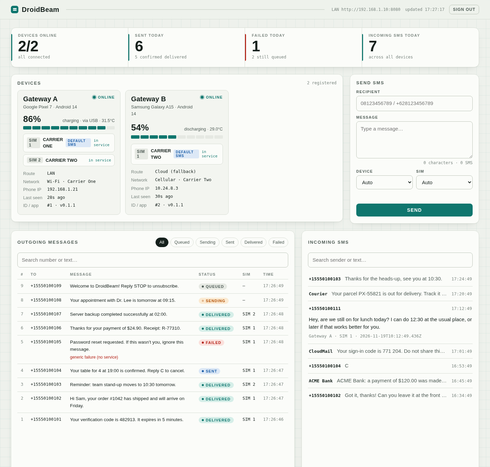

<div align="center">

# DroidBeam

**Turn any Android phone into a self-hosted SMS gateway.**

Send and receive SMS through a simple REST API, with a single-binary Go server, a live web dashboard and webhooks.

[](https://github.com/rayenking/DroidBeam/releases/latest)


<picture>
  <source media="(prefers-color-scheme: dark)" srcset="docs/screenshots/dashboard-dark.png">
  
</picture>

</div>

## Features

- **REST API** to send SMS and read incoming messages, with delivery reports (`queued` → `sending` → `sent` → `delivered` / `failed`).
- **Multiple phones and dual SIM**: pick a device and SIM per message, or let DroidBeam choose; it falls back to a SIM that has service.
- **Incoming SMS** forwarded to the server and to your webhook, never lost while the phone is offline.
- **Web dashboard** embedded in the server: device health, send form, searchable outgoing and incoming lists. Works on an offline LAN.
- **Webhooks** for message status, incoming SMS, battery thresholds, charger and online/offline events, optionally HMAC-signed.
- **LAN first, cloud fallback**: the phone talks to the server over the LAN and switches to your public domain when the LAN is unreachable.
- **Built to stay up**: foreground service, boot receiver, watchdog and retry queues on the phone; one static binary with SQLite on the server.

## How it works

```
Your app ──REST──▶ Go server ◀──long-poll── Android phone (DroidBeam) ──SMS──▶ recipient
                     │   ▲                       │
            webhook ◀┘   └── status / incoming SMS / battery / device info
```

| Folder | What |
|---|---|
| `server/` | Go server with SQLite (single binary, no C dependencies) and the embedded dashboard |
| `android/` | Kotlin + Jetpack Compose app (minSdk 26 / Android 8.0) |
| `scripts/` | Release build and a helper to look up the server's LAN address via its public domain |

## Quick start

```bash
git clone https://github.com/rayenking/DroidBeam.git && cd DroidBeam
cp .env.example .env          # set DROIDBEAM_API_KEY and DROIDBEAM_LAN_URL
docker compose up -d
```

1. Open `http://<server>:8080/` and sign in with the API key.
2. Install the APK from [Releases](https://github.com/rayenking/DroidBeam/releases/latest) on the phone, enter the server address and API key, and tap **Register device**.
3. Send your first message:
   ```bash
   curl -X POST http://<server>:8080/api/v1/messages \
     -H "X-API-Key: $KEY" -H "Content-Type: application/json" \
     -d '{"to":"+15550100101","body":"Hello from DroidBeam"}'
   ```

**Contents:** [Running the server](#1-running-the-server) · [Android app](#2-installing-the-android-app) · [API](#3-api) · [Webhooks](#4-webhooks) · [Development](#5-development)

---

## 1. Running the server

Use a prebuilt binary from [Releases](https://github.com/rayenking/DroidBeam/releases/latest):

```bash
tar xzf droidbeam-server_*_linux_amd64.tar.gz
DROIDBEAM_API_KEY=$(openssl rand -hex 24) ./droidbeam-server
```

Or build from source (Go 1.26+):

```bash
cd server
go build -o droidbeam-server .
DROIDBEAM_API_KEY=$(openssl rand -hex 24) ./droidbeam-server
```

Keep that API key: your application uses it, and so does the phone when you register it.

| Variable | Default | Description |
|---|---|---|
| `DROIDBEAM_API_KEY` | (required) | Secret, at least 16 characters |
| `DROIDBEAM_ADDR` | `:8080` | Listen address |
| `DROIDBEAM_DB` | `droidbeam.db` | SQLite file |
| `DROIDBEAM_WEBHOOK_URL` | – | URL that receives all webhook events |
| `DROIDBEAM_WEBHOOK_SECRET` | – | If set, webhook bodies are signed with HMAC-SHA256 |
| `DROIDBEAM_BATTERY_THRESHOLDS` | `20,80` | Battery levels (%) that trigger a webhook when crossed |
| `DROIDBEAM_LAN_URL` | (auto-detected) | LAN address advertised to phones and scripts, e.g. `http://192.168.1.10:8080`. Required when running in Docker |
| `DROIDBEAM_OFFLINE_AFTER` | `2m` | A phone is considered offline after this long without contacting the server |
| `DROIDBEAM_SEND_TIMEOUT` | `10m` | Messages picked up by a phone but never reported back are marked `failed` |

### Docker

```bash
cp .env.example .env      # fill in DROIDBEAM_API_KEY and DROIDBEAM_LAN_URL
docker compose up -d
docker compose logs -f
```

- Small image (~13 MB): a static Go binary on `distroless`, running as a non-root user.
- The database lives in the `droidbeam-data` volume (`/data/droidbeam.db`), so it survives container re-creation.
- **Set `DROIDBEAM_LAN_URL`** to the Docker host's LAN address, e.g. `http://192.168.1.10:8080`. From inside the container the server cannot see the host's LAN IP.
- The container has a healthcheck on `/healthz` and restarts automatically (`restart: unless-stopped`).
- Time zone defaults to `Asia/Jakarta`; it decides what "today" means on the dashboard. Change it with `TZ`.

Without compose:
```bash
docker build -t droidbeam-server ./server
docker run -d --name droidbeam -p 8080:8080 -v droidbeam-data:/data \
  -e DROIDBEAM_API_KEY=... -e DROIDBEAM_LAN_URL=http://192.168.1.10:8080 droidbeam-server
```

### LAN + public domain (one server, two addresses)

Run the server on your local network, then expose it to the internet through a domain, e.g. with Cloudflare Tunnel, a reverse proxy on a VPS, or port forwarding + HTTPS. The same server is then reachable at:

- **LAN**: `http://192.168.1.10:8080` (fast, keeps working when the internet is down)
- **Public**: `https://sms.example.com`

On startup the server prints the LAN addresses it detected:
```
LAN address(es) advertised to devices: [http://192.168.1.10:8080]
```

> Use **HTTPS** for the public address. Plain HTTP is for the LAN only.

### Web dashboard

Open `http://<server>:8080/` in a browser and sign in with the API key. The dashboard is embedded in the server binary and loads nothing from the internet, so it works on an offline LAN. It shows:

- **Today's summary**: devices online, messages sent, messages failed, incoming SMS.
- **Device cards**: online/offline, battery (level, charging, temperature), signal per SIM, route (LAN/cloud), IP and last seen.
- **Send SMS form** with an SMS segment estimate and device/SIM selection.
- **Outgoing messages** with a status filter, and **incoming SMS** as a compact list (click a row to read the whole message). Both lists scroll and have a search box (number/sender or text).
- Auto-refresh every 5 seconds (paused while the tab is hidden).

The API key is stored only in the browser (sessionStorage, or localStorage if "Remember on this browser" is checked). Do not open the dashboard over plain HTTP from the internet; use HTTPS for the public address.

---

## 2. Installing the Android app

**Easiest:** download the APK from [Releases](https://github.com/rayenking/DroidBeam/releases/latest) and install it on the phone (allow "install unknown apps").

Or build it yourself:
```bash
cd android
./gradlew assembleDebug
adb install -r app/build/outputs/apk/debug/app-debug.apk
```

You can also open the `android/` folder in Android Studio and press Run.

On the phone:
1. **Connect to server**: enter the *Cloud / domain address*, the *Server API key* and a device name. The *LAN address* can stay empty when "Discover LAN address via domain" is on. Tap **Register device**.
2. **Grant permissions** for SMS, SIM status and notifications.
3. **Exempt from battery optimization**. This is important so the system doesn't kill the gateway.
4. Turn on the **Gateway** switch.

### Staying alive (background / foreground / boot)

| Mechanism | Purpose |
|---|---|
| Foreground service (`remoteMessaging`) + persistent notification | Keeps running when the app is closed |
| `START_STICKY` | Android restarts the service if it is killed |
| `BootReceiver` | Starts automatically after reboot or app update |
| `WatchdogWorker` (WorkManager, every 15 min + 30 s after the service dies) | Revives the gateway if an OEM task killer stops it |
| Partial wake lock + Wi-Fi lock | Polling continues with the screen off / in Doze |
| Network callback | Reconnects immediately when the network comes back |
| Status reports & incoming SMS via WorkManager | Nothing is lost while offline; retried automatically |
| All loop errors are caught | One bad response cannot crash the app |

**Xiaomi / Oppo / Vivo / Realme / Samsung**: enable **Autostart** and set the app's battery mode to **No restrictions** (button *Open app settings*). This is **required**. Without Autostart, HyperOS/MIUI blocks the app from starting itself after a reboot or update (logcat shows `process is not permitted to auto start`). For a phone dedicated to being a gateway, keep it on a charger.

**Android SMS limit**: by default Android asks for confirmation when one app sends more than ~30 SMS in 30 minutes. On a gateway phone, raise the limit with adb:
```bash
adb shell settings put global sms_outgoing_check_max_count 10000
```
```bash
adb shell settings put global sms_outgoing_check_interval_ms 60000
```

### LAN → cloud fallback

- The app uses the **LAN** address first. If it can't connect, the request is retried via the **domain**.
- While on cloud, the app checks the LAN every 60 seconds (or right after a network change) and switches back when it can.
- With *Discover LAN address via domain*, the app asks the server for its LAN address via the domain (`/api/v1/device/server-info`) and verifies through `server_id` that the address really is the same server. If the server's LAN IP changes (DHCP), the phone follows automatically.

---

## 3. API

All client endpoints use the header `X-API-Key: <API key>`.

### Send SMS
```bash
curl -X POST https://sms.example.com/api/v1/messages \
  -H "X-API-Key: $KEY" -H "Content-Type: application/json" \
  -d '{"to":"+6281234567890","body":"Hello from DroidBeam"}'
```
Optional fields:
- `"device_id": 1`: send through a specific phone.
- `"sim": 2`: send through SIM 2. If omitted, the app uses the default SMS SIM; if that SIM has **no service**, it automatically switches to a SIM that does.

Response `202`:
```json
{"id":1,"to":"+6281234567890","body":"Hello from DroidBeam","status":"queued","device_id":null,"error":null,
 "created_at":"…","updated_at":"…","sent_at":null,"delivered_at":null,"sim":null,"sim_used":null}
```
`sim_used` is filled in by the phone with the SIM slot actually used.
Message status: `queued` → `sending` → `sent` → `delivered`, or `failed` (with `error`).

| Method | Path | Description |
|---|---|---|
| `POST` | `/api/v1/messages` | Send SMS (max 1600 characters, split into multipart automatically) |
| `GET` | `/api/v1/messages/{id}` | Status of one message |
| `GET` | `/api/v1/messages?status=&q=&limit=&before=` | List messages (newest first); `q` searches recipient and text |
| `GET` | `/api/v1/inbox?q=&limit=&before=` | Incoming SMS; `q` searches sender and text |
| `GET` | `/api/v1/devices` | All phones, including info and battery |
| `GET` | `/api/v1/devices/{id}` | One phone, including battery |
| `POST` | `/api/v1/devices` | Register a phone (normally done by the app) |
| `GET` | `/api/v1/server-info` | `server_id` + `lan_urls` (server LAN addresses) |
| `GET` | `/api/v1/stats` | Message counts per status (all time & today) + incoming SMS today |
| `GET` | `/healthz` | Health check (no auth) |

### Device info + battery
```bash
curl -H "X-API-Key: $KEY" https://sms.example.com/api/v1/devices/1
```
```json
{
  "id": 1, "name": "Office phone", "online": true,
  "created_at": "2026-11-18T11:27:21.845Z", "last_seen_at": "2026-11-18T11:30:02.112Z",
  "info": {
    "manufacturer": "Samsung", "model": "Galaxy A15", "android_version": "14", "sdk": 34,
    "app_version": "0.1.0", "operator": "Carrier One", "network": "wifi",
    "connection": "primary", "local_ip": "192.168.1.23",
    "sims": [
      {"slot": 1, "carrier": "CARRIER ONE", "in_service": false, "default_sms": true},
      {"slot": 2, "carrier": "CARRIER TWO", "in_service": true, "default_sms": false}
    ]
  },
  "battery": {
    "level": 100, "status": "full", "plugged": "ac", "temperature": 30.2,
    "health": "good", "updated_at": "2026-11-18T11:30:02.112Z"
  }
}
```
- `info.connection`: `primary` (LAN) or `fallback` (cloud).
- `info.local_ip`: the phone's IP on its network.
- `info.sims`: installed SIMs, whether each has service, and which is the default for SMS.
- `battery.status`: `charging`, `discharging`, `full`, `not_charging` or `unknown`.
- `battery.plugged`: `ac`, `usb`, `wireless`, `dock` or `none`.

The phone sends this whenever the battery level or charging state changes, and every 5 minutes as a heartbeat.

### Get the server's LAN address via the domain
```bash
DROIDBEAM_URL=https://sms.example.com DROIDBEAM_API_KEY=$KEY ./scripts/get-lan-ip.sh
```
Example output: `http://192.168.1.10:8080`.

Add `--check` to print only addresses reachable from the current machine (and verified to be the same server). The script is equivalent to:
```bash
curl -H "X-API-Key: $KEY" https://sms.example.com/api/v1/server-info
# {"lan_urls":["http://192.168.1.10:8080"],"server_id":"3be7bd7b…"}
```

---

## 4. Webhooks

Every event is sent as a JSON `POST` to `DROIDBEAM_WEBHOOK_URL`, with up to 4 attempts.

```json
{ "event": "battery.threshold", "data": { … }, "sent_at": "2026-11-18T11:30:02Z" }
```

| Event | When | `data` |
|---|---|---|
| `message.status` | A message's status changes | message object |
| `sms.received` | The phone receives an SMS | `{id, device_id, from, body, received_at, created_at, sim}` |
| `battery.threshold` | Level crosses a threshold (default 20% and 80%) | `device`, `battery`, `threshold`, `direction` (`down`/`up`) |
| `battery.full` | Battery is full | `device`, `battery` |
| `battery.charger_connected` | Charger plugged in | `device`, `battery` |
| `battery.charger_disconnected` | Charger unplugged | `device`, `battery` |
| `device.online` | Phone reconnects | `device` |
| `device.offline` | Phone hasn't contacted the server for > 2 minutes | `device` |

Example: "battery dropped to 20%" is `event == "battery.threshold" && data.threshold == 20 && data.direction == "down"`, and "battery reached 80%" is `threshold == 80 && direction == "up"`. To add more thresholds: `DROIDBEAM_BATTERY_THRESHOLDS=10,20,50,80`.

Headers on every request:
- `X-DroidBeam-Event: <event>`
- `X-DroidBeam-Signature: sha256=<hex>` (when a secret is set): HMAC-SHA256 of the raw body using `DROIDBEAM_WEBHOOK_SECRET`.

Verification example (Node.js):
```js
const sig = 'sha256=' + crypto.createHmac('sha256', SECRET).update(rawBody).digest('hex');
const ok = crypto.timingSafeEqual(Buffer.from(sig), Buffer.from(req.headers['x-droidbeam-signature']));
```

---

## 5. Development

```bash
cd server
go test ./...
```
```bash
cd android
./gradlew assembleDebug lintDebug
```

### Release build

Create `android/keystore.properties` (ignored by git) pointing to your keystore:
```properties
storeFile=/path/to/droidbeam-release.jks
storePassword=...
keyAlias=droidbeam
keyPassword=...
```

Then build everything into `release/`: server binaries for Linux (amd64, arm64, armv7), macOS (amd64, arm64) and Windows (amd64), the signed APK, and `SHA256SUMS`:
```bash
./scripts/build-release.sh 0.1.1
```
Without `keystore.properties`, Gradle produces an unsigned release APK.

> Release and debug APKs are signed with different keys. To switch from a debug build to a release build, uninstall the old app first, then register the device again.

### Notes
- The app can't be published on Google Play (SMS permissions are restricted); install it by sideloading.
- Device tokens are stored on the server as SHA-256 hashes and shown only once, at registration.
- Dual SIM support needs the *phone state* permission (`READ_PHONE_STATE`) to see which SIM has service.
- Databases from older versions are upgraded automatically when the server starts.
